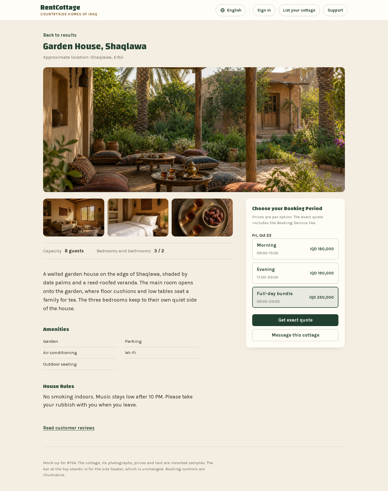
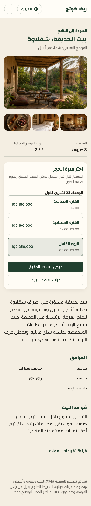

# Cottage page lifted look, October 2026

Record of the cottage blend approved for issue [#754](https://github.com/zaingulel/RentCottage/issues/754).
Not maintained. The issue owns implementation; [DESIGN-SYSTEM.md](../DESIGN-SYSTEM.md) owns production patterns.
The [lifted-look record](lifted-look-2026-10.md) supplies the approved Search results and Booking Request status
references for the same issue.

## Approved reference

[Open the cottage page](lifted-look-2026-10/cottage-page.html)

The approval question shown with these two captures was:

> Do you approve it for #754, or want anything adjusted first?

The owner's exact reply was:

> yeah i like it let's go with that approved

This approves the shown design for implementation. It does not authorize a push or preview deployment.
The captures are exact copies of the approved images. The saved HTML differs from the approved original only in
relative font and photo paths, rebased to open from this directory.

## Opening and sample content

Open the HTML from a repository checkout. It reads the repository's fonts and photographs by relative path and
needs no network. Add `?ar` to the address for Arabic and right-to-left layout; narrow the window for the phone
composition. The two captures show English desktop and Arabic phone. Sorani is not drawn in this reference.

The cottage, names, descriptions, rules, prices and Booking Periods are fictional samples. The photographs are
sample assets already in the repository. The header is a noninteractive stand-in; booking controls, actions and
links are illustrative and perform no booking or messaging transition. Production retains its real header and
footer, translations, public content and existing action destinations.

## Bounded production adaptations

These adaptations apply the approved composition through the existing design-system tokens and controls; sample
content does not become a production constant.

- Keep parchment, cream and forest surfaces; Changa display with Karla/Almarai body; 17px body, 34px/26px page
  titles, 20px section headings, 15px supporting text, 14px card and 8px control radii. Use the existing card
  shadow only on the named cards, 1120px page and 760px record widths, 18px gutters and 32px header gap. Map
  historical 20px card padding to 24px and the cottage's 40px prose gap to 48px. Add no palette, spacing step,
  breakpoint, motion, image control or shortened text.
- Show the first published photo across the full page column, 29rem high on desktop and 16:10 at or below
  47.5rem, cropped at `50% 62%`, with 24px clear space below. Remaining photos retain their order in three
  16:10 columns with 14px corners, wrapping extra rows, 12px gaps and 8px gaps on phone. Zero photos reserves no
  hero, gallery or photo gap; one photo shows only the hero. Never truncate the published media array.
- Align the desktop booking card with the thumbnail strip, or with facts when there are no thumbnails. Keep it
  static at every width. Capacity/room facts and prose sit directly on parchment with rules; description and
  House Rules use 20px text, section headings use 20px green display text, and amenities use two ruled columns.
  At or below 47.5rem the document and visual order is lead photo, thumbnails, facts, booking, then description,
  amenities, rules and reviews. Phone card padding is 16px.
- Use one fieldset per Service Day and the existing full-width outlined toggle: name over time at the start
  edge, price at the end, explicit unavailable text, selected tint/inset edge and shared focus rings. Keep the
  name-only accessible label and describe time, price and unavailability separately. The card has a green
  heading, the existing fee note and full-width quote/message actions. Preserve loading, stale selection,
  missing periods, disabled controls, cross-midnight times and unavailable prices.
- Search uses a wrapping ruled summary and lifted results: an 18rem photo beside the details, above them at
  47.5rem; From Price at the detail header's end; three option columns per Service Day, stacking at 47.5rem.
  At or below 40rem the order is overview, price, days, footer, with the price at the start edge and the ruled
  fee/action footer stacked with a full-width View cottage action. Extra days, historical fourth options,
  amenities, filters and paging remain; the fourth option wraps. No-photo results omit the empty frame.
- Customer Booking Request status uses a parchment title and three lifted groups: status/progress,
  reference/facts, and Messages/action. Customer Total sits between rules in the display face. Use the approved
  no-photo fallback: reference alone and Cottage first in the facts. Four progress columns remain on phone,
  labels wrap, and the 6px neutral track turns gold only after a completed step; markers and state text remain
  authoritative. Withdraw is content-width at the desktop end and full-width in its phone footer; recovery
  keeps its full-width treatment. Keep all deadlines, notes, errors and notification details.

The quote/form route and its pre-live gate, Confirmed/Cancelled Booking compositions and owner progress retain
their current designs. Authentication, selection rules, request outcomes, payments and private-data boundaries
are unchanged. The static captures do not prove production behavior or accessibility across all states and
languages; issue #754's running-view evidence owns those checks.
