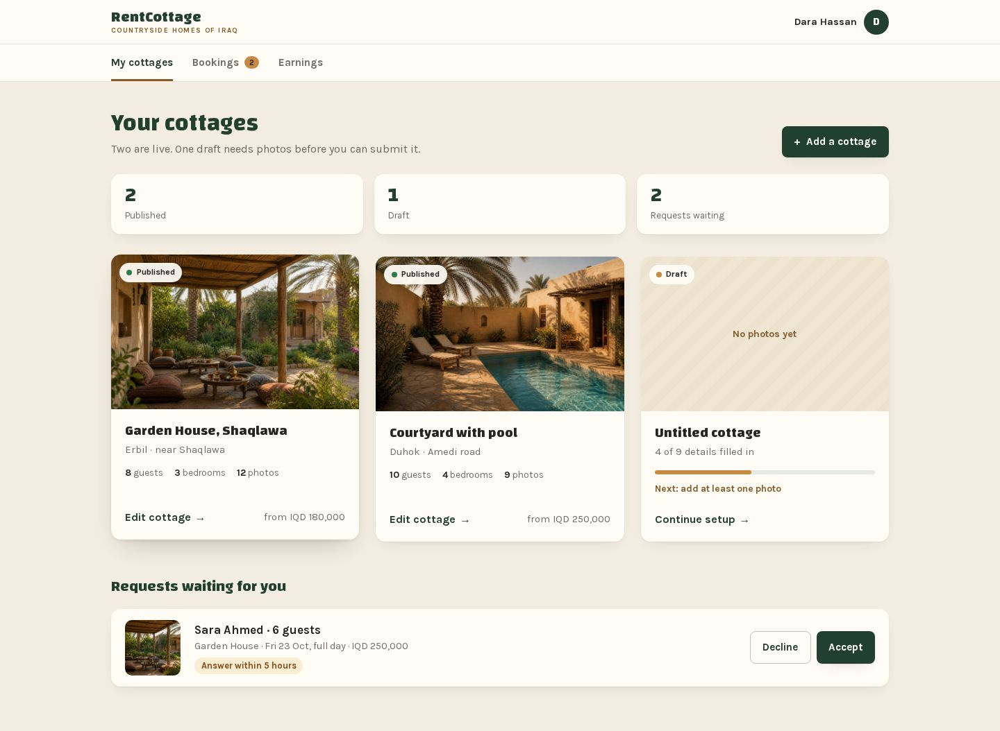
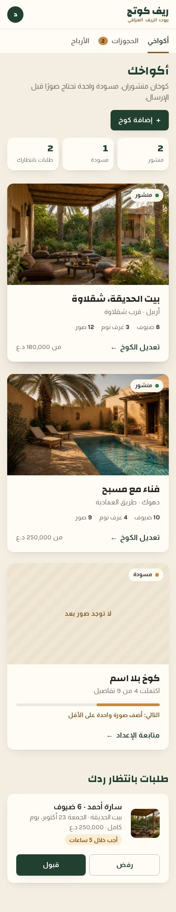
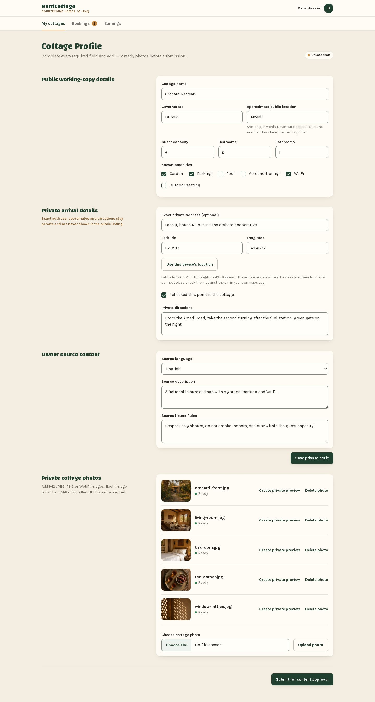
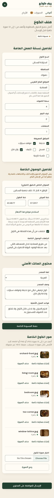
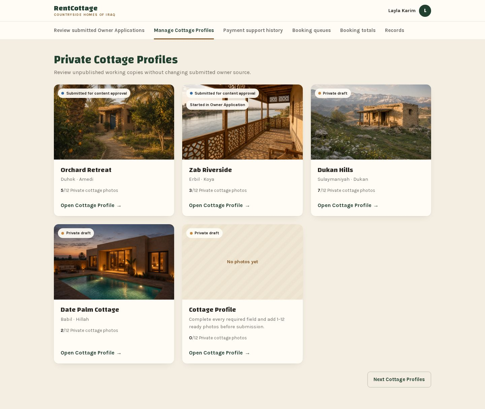
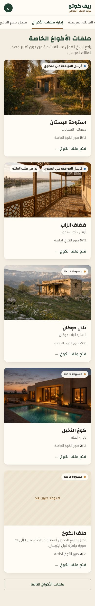
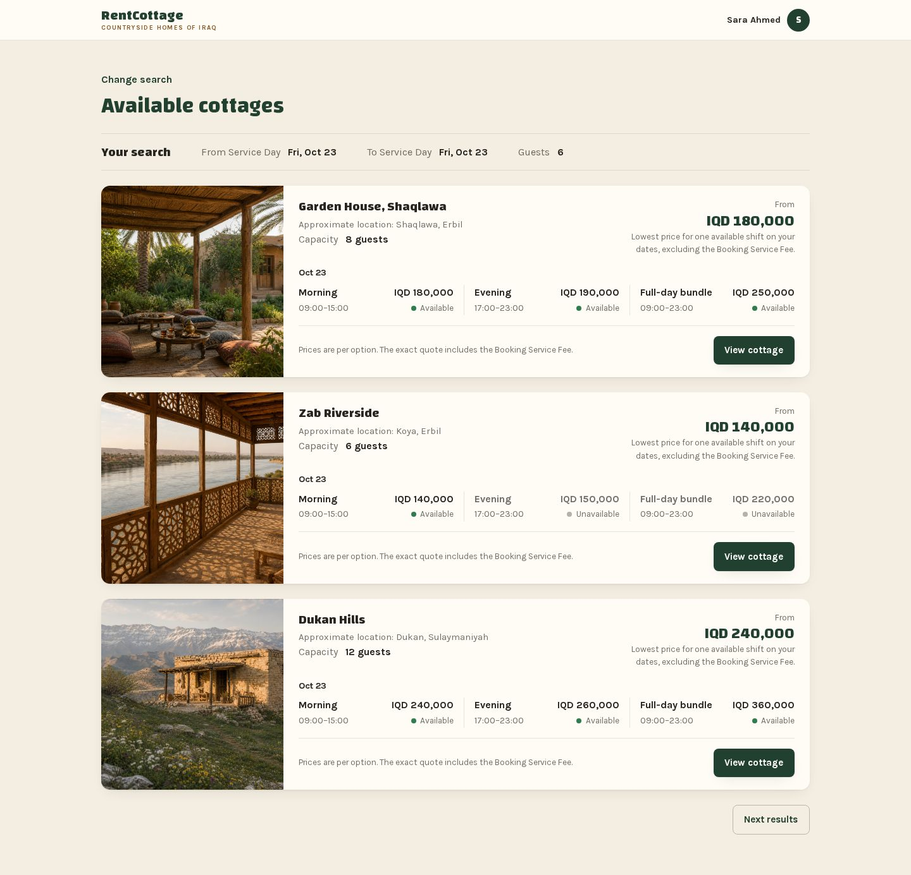
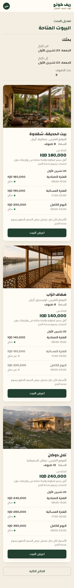
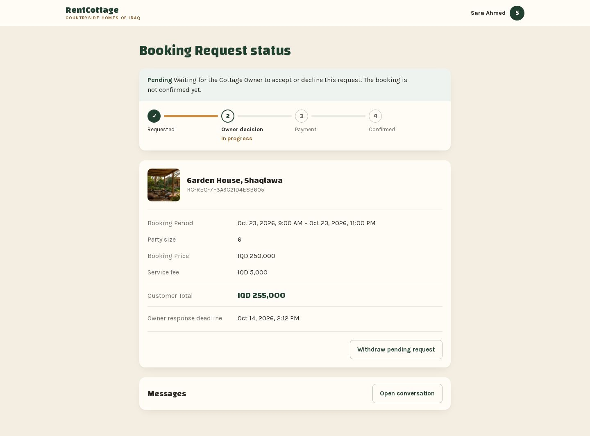
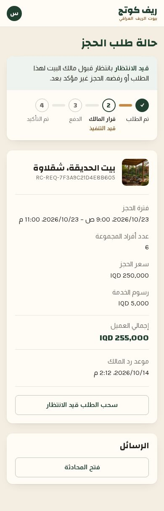

# Lifted look mock-ups, October 2026

Status: record of the mock-ups the owner approved: the owner cottages list on 14 October 2026, and four more pages on
14 October 2026 on issue [#743](https://github.com/zaingulel/RentCottage/issues/743), which holds the owner's words.
Not maintained. The issues linked from each list are the living copy.

Five pages are drawn in one look: a parchment ground, cream cards lifted off it with a soft shadow and a larger corner
radius, titles in the brand face, and one bold element per page. Each page below has two captures (1440 pixels wide in
English, 390 pixels wide in Arabic), a list of what is purely visual, and a list of what is new behaviour or new
information.

## How to open them

Each page is one self-contained HTML file that opens from a checkout of the repository with no network: double-click it
or open it from a browser. It reads its fonts and photographs from the repository by relative path, so it must be opened
from inside a checkout.

- To see Arabic, add `?ar` to the end of the address in the address bar. The page then turns right to left.
- To see the phone layout, narrow the window.
- They were made and checked in a Chromium-family browser. Other browsers are untested; a browser that refuses to load
  fonts from outside the page's own folder will show a fallback face.

## What the mock-ups are not

- The bar at the top stands in for the site header, which is unchanged. The tab bars under it are part of the
  drawing.
- A value in a mock-up becomes a rule only through the card that owns it. Nothing here changes the design system.
- Product work uses the design system's named breakpoints. The mock-ups use two of them, except the first, which keeps
  its own approved 700 pixel breakpoint.

## Owner cottages list

[Open the page](lifted-look-2026-10/owner-cottages.html)

*The Cottage Owner's list of cottages: summary counts, cottage cards with status pills, and waiting requests as rows.*

This stored copy sets its type in the repository's own font files where the approved original loaded Google's, so its
letters are slightly wider than in the captures the owner approved.

**Purely visual**

- Lifted cards, the larger radius, dotted status pills and label-sized buttons
  ([#744](https://github.com/zaingulel/RentCottage/issues/744)).

**New behaviour or new information**

- The tab bar ([#745](https://github.com/zaingulel/RentCottage/issues/745)).
- Cover photos and the "No photos yet" panel ([#746](https://github.com/zaingulel/RentCottage/issues/746)).
- The summary counts and sentence ([#747](https://github.com/zaingulel/RentCottage/issues/747)).
- Compact waiting-request rows with the deadline chip
  ([#748](https://github.com/zaingulel/RentCottage/issues/748), also named in #747).
- Draft progress and next step ([#749](https://github.com/zaingulel/RentCottage/issues/749)).
- The waiting count on the Bookings tab ([#750](https://github.com/zaingulel/RentCottage/issues/750)).
- The from price ([#751](https://github.com/zaingulel/RentCottage/issues/751)).
- The Earnings tab ([#752](https://github.com/zaingulel/RentCottage/issues/752)).
- Owned by no card: guest and bedroom counts on a card; the short tab names and the "Add a cottage" and "Edit
  cottage" wording; the Arabic money format "180,000 د.ع", which differs from the product's "IQD 180,000".

## Cottage editor

[Open the page](lifted-look-2026-10/cottage-editor.html)

*The Cottage Owner's editor for a draft that was never submitted, from the page title to the Submit button.*

**Purely visual**

- Section titles stand at the start edge and each section's fields sit in a lifted card; short fields sit side by
  side.
- The private-details warning and the photo guidance are text under their section title, no longer a tinted bar or a
  line inside the form.
- The status is the same pill as today with a coloured dot
  ([#744](https://github.com/zaingulel/RentCottage/issues/744)), placed on the title line.
- The buttons get an order of importance: Save and Submit filled, Upload and device location outlined, preview and
  delete as text. Today all are the same filled green button. Label-sized buttons are #744's.

**New behaviour or new information**

- A small picture of each photo in its row. Today a row shows the file name, and a private preview is made on request.
  Showing private photos in the page is the question
  [#746](https://github.com/zaingulel/RentCottage/issues/746) answers for list cards; for the editor it is owned by no
  card. Fallback if not adopted: the same rows without the thumbnail column.
- The owner's tab bar ([#745](https://github.com/zaingulel/RentCottage/issues/745)), the waiting count on Bookings
  ([#750](https://github.com/zaingulel/RentCottage/issues/750)) and the Earnings tab
  ([#752](https://github.com/zaingulel/RentCottage/issues/752)).
- The strength of the field edge: proposed, owned by [#714](https://github.com/zaingulel/RentCottage/issues/714). The
  mock-up draws the edge darker than the design system's standard hairline, which measures about 1.3 to 1 against the
  field.
- The lift of the page itself is [#753](https://github.com/zaingulel/RentCottage/issues/753)'s.

## Platform Administrator cottage list

[Open the page](lifted-look-2026-10/administrator-cottages.html)

*The list of private Cottage Profiles under the six-section navigation, with five cards and a continuation button.*

**Purely visual**

- Cards are lifted with the larger radius and the status is a dotted pill
  ([#744](https://github.com/zaingulel/RentCottage/issues/744)); a second pill carries "Started in Owner
  Application".
- The open action is a text link with an arrow; the continuation is an outlined button at the end.

**New behaviour or new information**

- The six sections as a tab bar on one line that scrolls sideways on a phone
  ([#745](https://github.com/zaingulel/RentCottage/issues/745)).
- The bar opening with the current section in view. #745's criteria do not name this; owned by no card unless #745
  takes it.
- A cover photo on each card and the "No photos yet" panel
  ([#746](https://github.com/zaingulel/RentCottage/issues/746)).
- The visible area label "Platform administration" is not drawn; how the navigation keeps its name is #745's.
- The wider administrator restyle is [#563](https://github.com/zaingulel/RentCottage/issues/563)'s.

## Search results

[Open the page](lifted-look-2026-10/search-results.html)

*The loaded results for one Service Day and six guests: three results, each with its options, and a next-results
button.*

The search results page prints the Arabic month as the product does ("23 تشرين الأول"); the first mock-up keeps its
approved "23 أكتوبر".

**Purely visual** (all of it; [#754](https://github.com/zaingulel/RentCottage/issues/754) owns the lift)

- Each result is a lifted card with its photograph beside the details on desktop and above them on a phone.
- The from price is a large figure at the end of the card.
- The options of a day sit side by side on desktop; availability is a dot and a word.
- The search summary is a ruled strip, not a box.

**New behaviour or new information**

- None.

## Booking Request status

[Open the page](lifted-look-2026-10/booking-request.html)

*The Customer's status page for a pending request: status and progress, the request details, and the messages row.*

**Purely visual**

- The status sentence and the progress share one lifted card.
- The progress line is thicker, with gold for the part already done.
- The facts sit in a lifted card; the Customer Total stands between two rules in the title face.
- Withdraw is an outlined, label-sized button at the end
  ([#744](https://github.com/zaingulel/RentCottage/issues/744)); Messages is one row with its button.
- All of this is [#754](https://github.com/zaingulel/RentCottage/issues/754)'s to lift.

**New behaviour or new information**

- The cottage's photograph beside its name. The page shows no photograph today. Owned by no card; which photograph
  shows if the cottage later changes or is unpublished is unsettled. Fallback if not adopted: the header row keeps the
  reference alone and "Cottage" returns to the fact list as its first fact, as today.

## Accessibility

The ten captured views were measured in Chromium against the Web Content Accessibility Guidelines 2.2, level AA: text
and non-text contrast, pointer target size, accessible names and roles, heading order, focus order and reflow. Three
colours changed as a result, and the owner accepted them on issue
[#743](https://github.com/zaingulel/RentCottage/issues/743): the digit on the count badge is ink on gold, the line
under the current tab is the accent colour, and the darker stripe of the "No photos yet" panel is one shade lighter.
The captures show the accepted colours.

- Not measured: a screen reader's announcement, browsers other than Chromium, zoom to 200 and 400 percent, text spacing,
  forced colours, a device scale factor of 2, Sorani, the error, disabled and loading states, any hover state beyond the
  one drawn, and the focus ring at widths other than 1440 and 390. Keyboard focus was measured as each view renders it,
  and reflow was also measured at 320 and 720 pixels wide.
- On the Platform Administrator cottage list at 390 pixels wide in Arabic, a tab cut by the edge of the bar shows its
  focus ring on three sides until the bar is scrolled; the first and third tabs open that way.
  [#745](https://github.com/zaingulel/RentCottage/issues/745) inherits this with the bar's opening position.
- These measure below 3 to 1 and pass only because text beside them carries the same information: the outlined
  button's edge, the status dots and the progress tracks. A card that makes one of them the only cue must darken it.

## Sample content

All names, places, prices, addresses and directions are invented for the mock-ups, and the Arabic sample content has
had no second reading. No picture was missing, so none was generated; every photograph is one of the sample photographs
already in the repository.

## Not shown

- Sorani. The design system gives Sorani titles a taller line height, so
  [#753](https://github.com/zaingulel/RentCottage/issues/753) and
  [#754](https://github.com/zaingulel/RentCottage/issues/754) must check it.
- Every state other than the one drawn; widths between 390 and 1440; hover, focus, error, disabled and pending states.
- The editor's four lower blocks: the shift schedule, pricing and availability, publication review and lifecycle.
- The administrator tab labels are sentence-length, so about one and a half tabs show at 390. Shorter labels would be a
  wording change no card owns.
- The first mock-up keeps its approved wording: "Answer within 5 hours" although the Response Deadline is four hours
  ([#748](https://github.com/zaingulel/RentCottage/issues/748) owns the wording), and the Arabic money format noted
  above.
